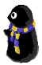
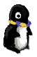

# Labmap2




Labmap2 is a full rewrite of the OCF's labmap project, including new features and fixing old issues with
the software. This program uses a combination of systems and languages in order to achieve the goal
of having up-to-date information as well as the ability to make changes to the arrangement of the 
devices in the OCF. Furthermore, the ability to customize setups in addition to each users avatars or
"Waddles" is possible with this new version of Labmap.

## Architecture Diagram


## Running the client locally

Running `nix develop` in the Git repository will setup and run the Godot editor.

## Running the server locally

The server that hosts the API and labmap client WASM can be run with Docker:

```
docker build -t labmap2-server:latest .
docker run --env-file .env -p 8081:8081 --name labmap2-server labmap2-server:latest
```
